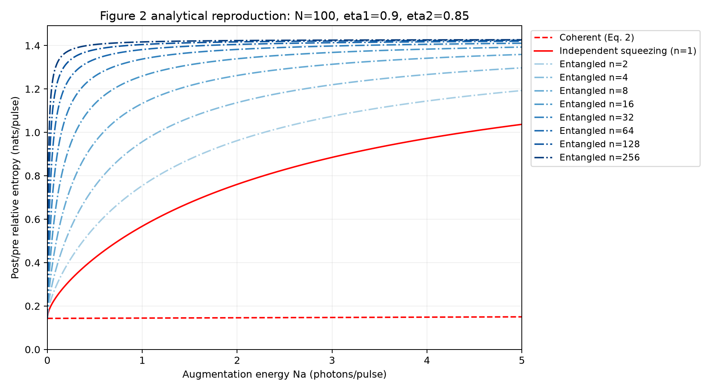

# Quantum-enhanced transmission-loss change detection

Python simulations of [Guha et al., arXiv:2503.12276v2](https://arxiv.org/html/2503.12276v2).
Compares coherent, squeezed and entangled light using Page CUSUM to detect a
change in channel loss. Runs on a classical computer.

## Results

- **Reproduced:** Figure 2's analytical curves and the single-photon KL benchmark
  (**0.206340**, versus the paper's **0.2063**).
- **Additional studies:** rare-event false-alarm validation, channel mismatch,
  conservative thresholds and an explicit ideal dual-rail model.
- **Unresolved:** Figure 3/7 delays and Figure 4/5 comparisons. This is a
  **partial numerical reproduction**, with no hardware experiment claimed.

**419 tests · 1,869 core checks · 984 additional checks.**

[Full results and limitations](results/REPORT.md) ·
[Notebook](notebooks/01_paper_walkthrough.ipynb) ·
[Executed example](notebooks/02_executed_walkthrough.ipynb)



## Run

Python 3.10+. From the repository root:

```sh
python -m venv .venv
source .venv/bin/activate
python -m pip install -e '.[dev]'
python -m pytest -q
python -m lossqcd.walkthrough --output results/walkthrough_new
```

Tests and the lesson need no data download. Use fresh output folders.
`requirements-lock.txt` records the original Python 3.14.2 environment.

## Check saved simulations

```sh
python -m lossqcd.evidence --scope core
python -m lossqcd.reproduction_report --output results/review_new
python -m lossqcd.reproduction_report --check results/review_new
```

[Release archives](https://github.com/Rigur-Calypso/quantum-loss-change-detection/releases/tag/v0.1.0):
core **570 MiB**; `--scope all` **1.8 GiB**. Files are checksum-verified and
restored under `data/studies/`. These commands check saved evidence; they do
not regenerate every random trajectory. See the [report](results/REPORT.md)
for regeneration commands and the [manifest](data/evidence.json) for hashes.

By Bhagyesh Kamal. Independent of the paper's authors.
Code: MIT. Data/plots: CC BY 4.0. [Attribution and license details](LICENSE).
