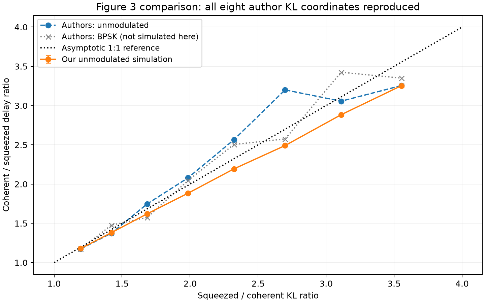
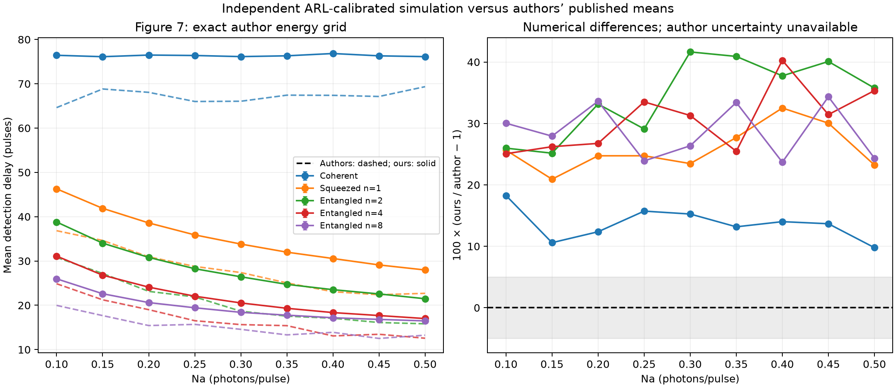

# Paper reproduction report

**Main paper models implemented; complete numerical reproduction remains unresolved.**

[Paper](https://arxiv.org/html/2503.12276v2) · [Coverage details](../PAPER_IMPLEMENTATION.md)

## Evidence at a glance

- Original author-grid study: 61/61 settings internally confirmed at ARL near two million.
- New BPSK/DV study: 17/17 settings independently confirmed.
- Figure 3 mean absolute delay-ratio differences: 7.49% unmodulated, 6.40% BPSK.
- DV entropy: 0.206340 nats, versus the paper's rounded 0.2063.
- DV conditional delay: 54.640 ± 0.129 pulses (one SE).

ARL confirmation and audit passes validate our internal calculations. They do not establish published latency agreement.

## Figure-by-figure coverage

| Figure | Evidence status | Implemented | Remaining limit |
| --- | --- | --- | --- |
| [Eq.1](../results_delay_scaling/delay_scaling.png) | Finite-ARL scaling checked | Fourteen scalar settings; rare-event ARL and direct delay validation. | Asymptotic trend, not an exact finite-delay formula or proof of a worst-case theorem. |
| 1 | Observation models implemented | Coherent, squeezed and entangled transmitter laws. | Hardware schematic, not an optical implementation. |
| [2](../results_entangled/figure2_entangled.png) | Equations checked | All coherent, squeezed and n=2–256 per-pulse entropy curves. | No original numeric figure array for pointwise comparison. |
| [3](../results_author_comparison/figure3_overlay.png) | Author-data difference remains | Eight unmodulated and eight BPSK energy settings; ARL validated. | Delay ratios differ from published data. |
| [4](../results_verified_figures_v2/fixed_seed_equation_check.png) | Published ordering unresolved | Fixed-seed equations, dense covariance and random checks agree. | Equations give n=1 ≥ n=2; published inset gives n=2 > n=1. |
| [5](../results_equation_validation/independent_checks.png) | Published Kennedy curve unresolved | Legend settings verified; independent Eq.10 integration and sampling agree. | About 12-fold Kennedy gap; roughly 10-photon diagnostic is not the stated setting. |
| 6 | Receiver laws implemented | Homodyne, photon-resolving and binary receiver statistics. | No optical or electronic hardware implementation. |
| [7](../results_author_comparison/figure7_overlay.png) | Author-data difference remains | 45 settings: five detector families at nine energies; ARL validated. | Our mean delays are approximately 13.6–34.4% higher by family. |
| 8–10 | Statistical network checked | BPSK mixtures, displaced squeezed laws, Hadamard covariance propagation. | No capacity-achieving code or physical Green Machine. |
| [11(a)](../results_paper_completion/photon_probe_comparisons.png) | Equation benchmark checked | Single-photon quadrature law, CDF, sampler and entropy. | 0.206340 agrees with quoted 0.2063; plot uses rounded tap. |
| [11(b)](../results_paper_completion/figure11b_comparison.png) | Latency statistic differs | DV detector independently calibrated; CV and BPSK comparisons saved. | Our conditional first-alarm delay differs from source signed latency mean. |
| [12](../results_verified_figures_v2/verified_receiver_curves.png) | Sparse pixel agreement | Seven curves within 2% at 1 dB; legend settings verified. | Sparse approximate pixels, not full numeric source data. |

## Interpretation and limits

Delay means are E[T−nu | T>=nu], with early first alarms and censoring tracked separately. These are not Lorden worst-case delays. ARL intervals are approximate Monte Carlo evidence, not certified finite-sample bounds.

The source single-photon latency array contains two negative values and its plotting script uses a signed mean. Our first-alarm conditional mean is a different statistic. Author uncertainty estimates and original Figure 3/7 thresholds are unavailable.

The 10.0570-photon Kennedy fit uses one pixel point; three others are held out. It is a non-unique diagnostic, not an inferred author parameter or a correction to N=100.

Robust-threshold, channel-mismatch and uncertainty studies remain separate research extensions. Hardware, capacity-achieving codes and the paper’s open optimal tradeoff problem are not claimed as implemented.

## Direct check of Eq.1

All 14/14 coherent/squeezed settings pass independent ARL and cold-start delay checks, from target ARL 100 to 100 million pulses. At the largest targets the change in delay per log(ARL) agrees with 1/KL: normalized slopes 1.000138 coherent and 1.000084 squeezed.

The absolute cold-start delay remains below log(ARL)/KL at finite targets. Delay counts E[T−1]; counting post-change samples instead adds one. This is supporting numerical scaling evidence, not a proof of a worst-case theorem or an explanation of published numerical latency gaps.

[Scaling data, grid checks, first-alarm handling and exact-regeneration commands](../results_delay_scaling/RESULTS.md)

## Combined verification

Current audit result: **PASS**; 1795 component checks. This run reads saved ensembles and recalculates summary/formula checks; it does not rerun the historical random draws.

| Component | Passed | Checks |
| --- | --- | --- |
| results_entangled Figure 2 table | True | 11 |
| results_author_comparison | True | 185 |
| results_paper_completion | True | 319 |
| results_verified_figures_v2 | True | 957 |
| results_equation_validation | True | 100 |
| results_delay_scaling | True | 223 |

## Reproduction

Run from the existing project environment:

```sh
python -m lossqcd.reproduction_report --output paper_reproduction_repeat
python -m lossqcd.reproduction_report --check paper_reproduction_repeat
python -m pytest -q
```

Each build needs a fresh output directory. The build runs five original audit modules in temporary linked directories, adds the Figure 2 table check, and saves new audit records here. Original audit.json files remain unchanged. Manifest checking detects changes to the recorded source/code/data and generated report files; the manifest itself is not an external signature.

For exact random regeneration use the separate study commands in their linked results documents. Cached study reports contain absolute source paths; moving the project may require regenerating those studies with updated source paths. No new paper PDF download is required.

## Next source evidence needed

1. Figure 4: original fixed-seed covariance and energy-conversion calculation.
2. Figure 5: original probe amplitude/energy and numerical plotting array.
3. Figures 3/7/11: thresholds, false-alarm calibration, first-alarm arrays and event conventions.

[Detailed independent checks and source questions](../results_equation_validation/RESULTS.md)

## Selected plots

### Figure Eq.1


### Figure 2


### Figure 3



### Figure 7



### Figure 11(b)


### Figure 12


### Figure 5


