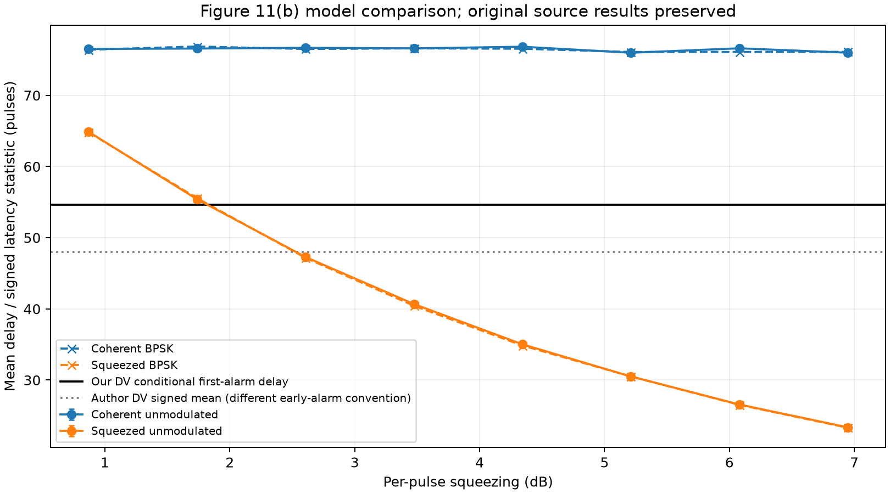
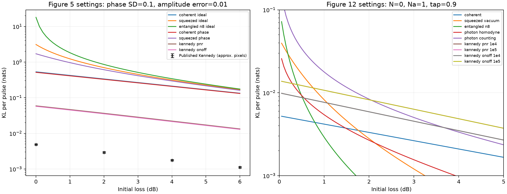
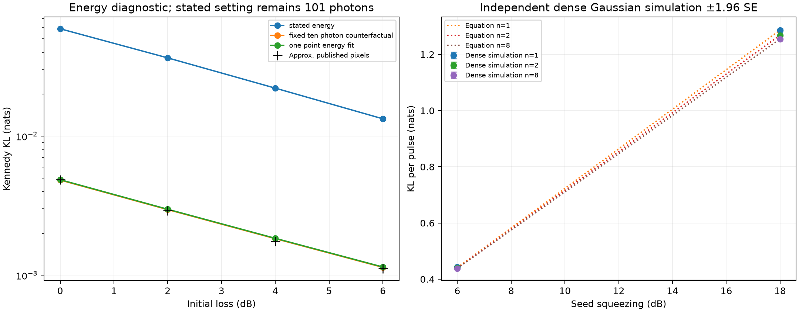
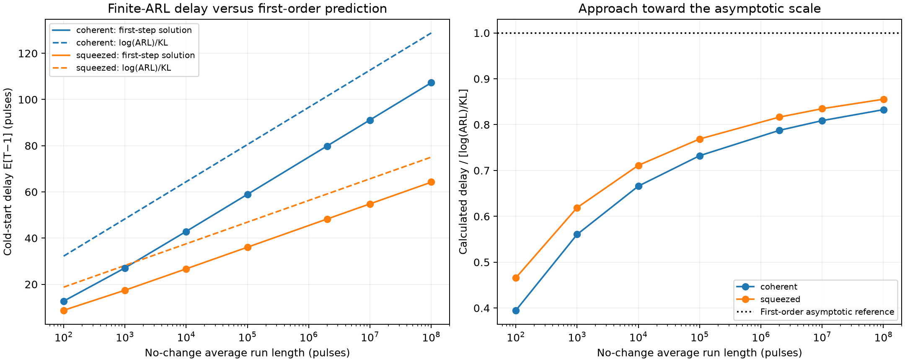
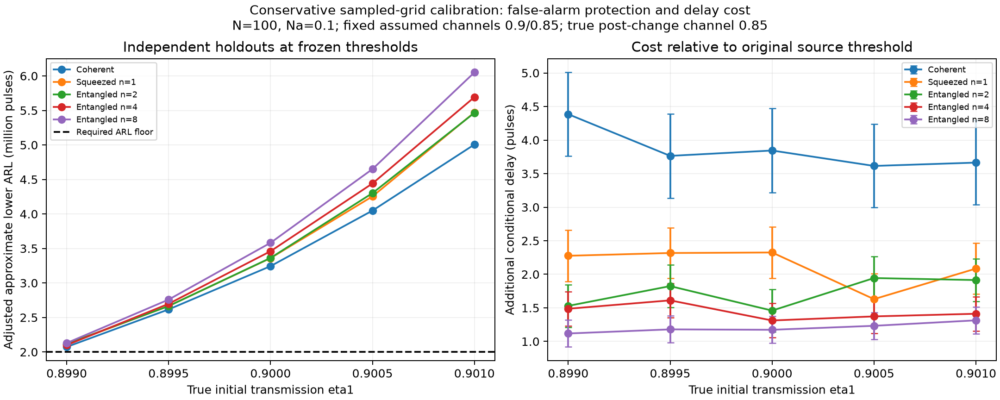

# Results and implementation

Independent computational study of [Guha et al., arXiv:2503.12276v2](https://arxiv.org/html/2503.12276v2).
The main observation models and detectors are implemented. Some numerical
benchmarks agree; complete agreement with the published figures remains unresolved.

## Paper comparisons

| Paper item | Implementation and result | Remaining limit |
| --- | --- | --- |
| Eq.1 | Fourteen coherent/squeezed settings, target ARL 100–100 million. At high ARL, normalized delay slopes agree with 1/KL within 0.014%. | Finite cold-start delays have an offset; this does not prove a worst-case theorem. |
| Figures 1, 6 | Transmitter statistics and homodyne, photon-resolving and on/off receiver laws. | Statistical simulation, not optical hardware. |
| Figure 2 | Coherent, independent squeezing and n=2–256 entangled per-pulse KL curves. | Formula reproduction; no original numeric figure array for pointwise comparison. |
| Figure 3 | BPSK and unmodulated detection on all eight author energy points. KL coordinates agree to machine precision. | Mean absolute relative delay-ratio differences: 7.49% unmodulated, 6.40% BPSK. |
| Figure 4 | Fixed-seed calculations and an independent dense Gaussian calculation agree. | A/n+B, A≥0, gives n=1 ≥ n=2 ≥ n=4; the published inset orders n=2 above n=1. |
| Figure 5 | Independent integration and samples support the implemented phase-noisy Kennedy equation. | PNR KL is 11.9–12.6 times four digitized published values. On/off coarse-graining does not close the gap. |
| Figure 7 | Five detector families across nine energies; exact mixed-loss blocks and pulse-level first alarms. | All 45 internal ARL checks pass, but family-average delays are 13.6–34.4% higher than author data. |
| Figures 8–10 | BPSK mixtures, displaced squeezed laws and normalized Hadamard covariance propagation. | Covariance error is below 2.8×10⁻¹⁷; no capacity-achieving code or physical Green Machine. |
| Figure 11(a) | Single-photon density, CDF, exact sampler and KL integration. KL is 0.206340 nats, versus the quoted 0.2063. | The squeezing crossover is 1.812 dB, close to the text's rounded 1.83 dB. |
| Figure 11(b) | Independently calibrated photon detector and CV/BPSK comparisons. | Our conditional DV delay is 54.640±0.129 pulses (one SE); the author's signed mean is 48.034 and includes two negative latencies. |
| Figure 12 | Seven approximate raster comparisons at 1 dB agree within 2%. | Sparse pixel agreement, not a complete curve reproduction. Zero-loss photon-counting KL is infinite. |

The Figure 3/7 study has supporting ARL checks for all **61 author-grid settings**.
Thresholds were calibrated to false-alarm requirements, not fitted to published delays.

For Figure 5, the verified settings are N=100, Na=1, tap=0.9, fractional amplitude
error 0.01 and phase **variance** 0.01, hence SD=0.1 rad. Energy matching gives
101 photons for the classical probe. The corresponding Figure 12 settings are
N=0, Na=1, n=8, tap=0.9 and residual photons 0.0001/0.00001. In Appendix A,
Eq.7 uses absolute residual amplitude; Eq.10 uses fractional LO amplitude error.

A roughly ten-photon Kennedy counterfactual and a fitted-loss diagnostic are
exploratory explanations, not verified author parameters or reproduced figures.
The DV nonnegative re-summary is 50.181 pulses under the complete-first-alarm
interpretation. Its remaining 4.459-pulse gap has bootstrap interval
[2.665, 6.206], conditional on independence and missing-event assumptions.
This does not identify a source error.

## Additional studies

- **Rare false alarms:** regenerative cycles and a history-dependent mixture
  proposal independently check large ARLs. Direct moderate-ARL comparisons,
  holdouts, effective sample size and weight-concentration checks are retained.
  Two fixed-threshold follow-ups support the previously unresolved settings,
  giving 25/25 supported points on that exploratory grid.
- **Initial-channel mismatch:** with assumed η₁=0.9, varying true transmission
  from 0.899 to 0.901 changes classical ARL from about 1.31 to 3.01 million.
  Actual-null path weights are checked separately for scalar and correlated laws.
- **Conservative thresholds:** independent holdouts pass on 25 sampled
  detector/channel settings. Adjusted approximate lower ARLs exceed two million,
  with delay costs of 3.61–4.39 pulses for the classical detector and 1.12–2.33
  for the squeezed/entangled examples. This is sampled-grid evidence, not a
  guarantee over a continuous interval.
- **Ideal dual-rail qubits:** arbitrary states, Kraus loss maps, heralded survival
  and a change between rails are explicit. Uniform loss preserves a surviving
  state; unequal loss can distort it. Two holdouts support the two-million-bin
  ARL target. This develops the Appendix E.2 model, without cavity dynamics or
  a QKD-security claim.

These are implementation and validation contributions. Research novelty has
not been established by a broader literature review.

## Follow the implementation

| Step | Code | Convention to retain |
| --- | --- | --- |
| Define observations | [Gaussian models](../src/lossqcd/models.py), [entangled blocks](../src/lossqcd/entangled.py), [other probes](../src/lossqcd/paper_models.py), [receivers](../src/lossqcd/receivers.py) | Variances, not standard deviations; log likelihoods and KL are in nats. BPSK information is in bits/pulse. |
| Accumulate evidence | [Page CUSUM](../src/lossqcd/cusum.py) | First strict crossing W>h; earliest minimum prefix for a tied change-point estimate. |
| Simulate first alarms | [Scalar](../src/lossqcd/simulation.py), [conditional blocks](../src/lossqcd/conditional_detection.py) | One-based pulses. No restart after an early alarm. A Page reflection does not erase a correlated block prefix. |
| Match false alarms | [Numerical calibration](../src/lossqcd/arl_solver.py), [conditional renewal](../src/lossqcd/conditional_rare_event.py) | Freeze thresholds before independent holdouts. Correct path weights use the whole proposal density. |
| Summarize performance | [Stopping-time summaries](../src/lossqcd/simulation.py), [pooled moments](../src/lossqcd/batched_rare_event.py) | Separate early alarms and censoring. Pool moments before taking an ARL ratio. |
| Recheck evidence | [Evidence loader](../src/lossqcd/evidence.py), [combined auditor](../src/lossqcd/reproduction_report.py) | Verify hashes; stage core audits so downloaded historical audit files remain unchanged. |

Delay means **E[T−ν | T≥ν]**: zero when the first changed pulse alarms.
This is not Lorden's worst-case delay. With censoring, unrestricted ARL/delay
is unavailable; summaries expose restricted means instead. Approximate Monte
Carlo intervals, numerical mesh checks and importance-weight diagnostics are
not certified error bounds.

For entangled probes the seed energy is n·Na. The independently squeezed
control uses Na. Mixed-loss blocks retain their physical covariance. A dual-rail
herald is available at the end of two time bins, so pair counts and pulse counts
must remain distinct.

Infinite KL under an ideal null does not imply zero finite-energy waiting time:
detection still requires a changed photon click.

The single-photon sampler implements the exact vacuum/Fock-1 mixture. Shared
threshold experiments use unreset null trajectories; thresholds crossed on the
same pulse receive the same stopping time, and their estimates are correlated.
The exact positive squeezing/coherent energy crossover is 930.513 photons,
versus the Appendix B.3 large-energy approximation of 900 for N=100, η₁=0.9.

## Plots

### Relative entropy — Figure 2


### Delay improvement — Figure 3


### Detection delay — Figure 7


### Discrete-variable comparison — Figure 11



### Weak probes — Figure 12



### Independent Figure 4/5 checks



### Finite-ARL scaling



### Conservative thresholds



### Ideal dual-rail channel


## Reproduce

The [README](../README.md) covers installation and saved-data checks. Detailed
study sidecars are in `data/metadata.tar.gz`; the two release archives contain
unchanged raw ensembles. The loader restores them under `data/studies`.
Earlier failed settings retain their labels in those historical records.

To generate new ensembles, use fresh output folders:

```sh
python -m lossqcd.author_comparison --output results/author_new
python -m lossqcd.paper_completion --source results/author_new --output results/paper_new
python -m lossqcd.audit_paper_completion results/paper_new --regenerate --regenerate-calibration
python -m lossqcd.verified_figures --output results/figures_new
python -m lossqcd.equation_validation --source results/figures_new --output results/equations_new
python -m lossqcd.audit_equation_validation results/equations_new --regenerate
python -m lossqcd.delay_scaling --output results/scaling_new
python -m lossqcd.audit_delay_scaling results/scaling_new --regenerate
python -m lossqcd.dual_rail_experiment --output results/dual_rail_new
python -m lossqcd.audit_dual_rail results/dual_rail_new --regenerate
```

The individual `audit_*` modules optionally regenerate recorded seeds and write
an `audit.json` beside their input. Use a copy of the study folder when retaining
the original audit record. The combined core auditor stages this automatically.
`dv_uncertainty` re-analyzes latency samples; `source_audit` inspects cached public
source archives without executing them. The original manuscript archives must
be obtained from their recorded URLs; they are not redistributed here.

The remaining author clarifications are the Figure 4 fixed-seed calculation,
the Figure 5 energy/PNR plotting calculation, and Figures 3/7/11 thresholds and
event conventions. An optical experiment, capacity-achieving communication code,
QKD security and the open optimal communication/detection tradeoff are outside
this implementation.

[Numeric summary](summary.csv) · [Validation record](validation.json)
