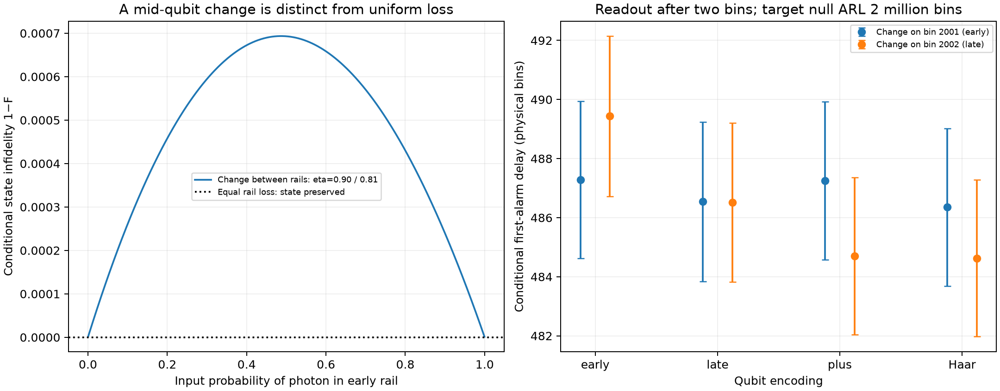

# Dual-rail quantum communication and loss detection

This implements the ideal logical channel discussed in
[Appendix E.2 of the paper](https://arxiv.org/html/2503.12276v2#A5.SS2).
An arbitrary qubit is encoded in one photon across two time bins. The receiver
gets a survival/loss herald without measuring which rail contains the photon.
Its Bernoulli record drives Page CUSUM. Qubit states, erasures and physical
timing are now represented explicitly, extending the earlier Bernoulli API.

This is **an ideal state/channel simulation**, not an implementation of the
Duan-Kimble cavity dynamics, a quantum-memory interface, a complete BB84/QKD
security protocol or a capacity-achieving quantum code. Ideal receiver phase
correction is subsumed into the logical surviving-state map. The open optimal
communication/detection tradeoff remains open.



## State propagation

Input basis: early-rail photon and late-rail photon. Output basis: vacuum,
early-rail photon, late-rail photon. Three Kraus matrices describe survival,
early-rail loss and late-rail loss; their adjoint-products sum to the identity.
For equal rail transmission eta, the output is a vacuum erasure with
probability 1−eta, plus the original qubit density matrix multiplied by eta.
Conditioning on a successful ideal herald therefore returns the original
qubit state, including its coherence. We do not measure the rail to obtain
the herald.

For 1,500 random pure qubit states at eta=0.9, the largest survival-probability
error and largest absolute deviation of surviving-state fidelity from one are
both **4.45×10⁻¹⁶**. Tests additionally cover mixed states, trace preservation,
positivity, no-loss and total-loss boundaries. Complete loss returns no
received qubit; an arbitrary state is not fabricated.

If a channel change occurs between the two rails, equal-loss assumptions do
not apply to that one qubit. Survival becomes
`p_early*eta_early + (1-p_early)*eta_late`; the surviving amplitudes are weighted
by their respective square-root transmissions. For eta_early=0.9 and
eta_late=0.81, the largest sampled conditional infidelity is **0.0006935**.
This transient is due to differential channel attenuation, not a measurement
of the encoded information. The paper's homogeneous-loss preservation claim
is kept distinct from this explicitly modeled boundary case.

## Detector and timing convention

There is **one herald per two-bin qubit**. We assume that the herald is available
at the end of both bins; no hardware processing time is added. A first alarm
on qubit q therefore has physical readout time 2q.

- A no-change ARL of one million qubits means two million physical time bins.
- A change on physical bin 2001 starts qubit 1001; detection on that qubit
  has physical delay one bin, even though its pair-count delay is zero.
- A change on physical bin 2002 straddles qubit 1001; detection there has
  physical delay zero. Its actual survival law is state-dependent for that
  one mixed-loss qubit.

Physical delays use `2*T_pair − change_pulse`, never a blind doubling of a
pair-based delay. Early first alarms and right-censored paths retain the same
explicit treatment as the rest of the package. The detector scores the fixed
pre/post Bernoulli laws and does not receive the true change time or secret
qubit amplitudes. Actual channel parameters enter the observation generator.

## Reproducible experiment

Use eta1=0.9, eta2=0.81. Six independent Monte Carlo calibration rounds choose
a threshold for target ARL one million qubits. At the frozen threshold
**10.0554075**, two fresh 250,000-cycle ensembles per sampling law give:

| Holdout | Estimated ARL, qubits | Estimated ARL, physical bins |
| --- | --- | --- |
| 1 | 1,004,223 ± 10,035 | 2,008,446 ± 20,069 |
| 2 | 1,006,861 ± 9,954 | 2,013,723 ± 19,908 |

Uncertainties shown are one approximate Monte Carlo SE. Both holdouts pass
weight/repetition diagnostics and their approximate 95% intervals are contained
within ±5% of the target. A moderate-threshold direct no-change simulation
agrees with the weighted renewal estimate within **0.071 combined SE**.
No threshold or latency is fitted to a published figure.

Eight changed ensembles combine early, late, equal-superposition and Haar
encodings with change on physical bin 2001 or 2002. Each uses 30,000 independent
runs. Conditional physical delays span **484.6–489.4 bins**, with individual
SEs approximately **1.35–1.39 bins**. Early-alarm counts range 15–30 per
30,000 trials and are stored separately. All changed runs finish without
post-change censoring. The finite differences across independently sampled
ensembles are not claimed as a statistically established ranking of encodings.
Under homogeneous loss, tests using a shared herald coin stream show exact
encoding independence of the detector trajectories.

One photon per two physical slots also means mean input energy one-half photon
per slot. This experiment is not presented as an equal-energy comparison with
the paper's one-photon-per-slot Figure 12 curves. State propagation and the
mid-pair timing example add an ideal communication model, not a new published
numerical benchmark.

## Validation and use

The full suite passes **406 tests**. This study passes **92 audit checks** with
exact regeneration of all six calibration rounds, holdout/control cycles,
eight changed ensembles and the 1,500 state samples. The source report, raw
first-alarm/renewal arrays, complex state vectors, CSV and PNG/SVG plots are
retained in this folder.

```sh
python -m lossqcd.dual_rail_experiment --output results_dual_rail_repeat
python -m lossqcd.audit_dual_rail results_dual_rail_repeat --regenerate
```

Use a new output folder and the existing numerical environment. No quantum SDK
or additional dependency is needed. For a single state:

```python
import numpy as np
from lossqcd.dual_rail import pure_state, heralded_state
rho = pure_state([1/np.sqrt(2), 1j/np.sqrt(2)])
probability, received = heralded_state(rho, eta_early=0.9)
# probability is 0.9; received equals rho, conditional on successful arrival.
```

Existing paper-figure discrepancies and missing source thresholds remain
unresolved. This addition does not change or replace earlier evidence.
