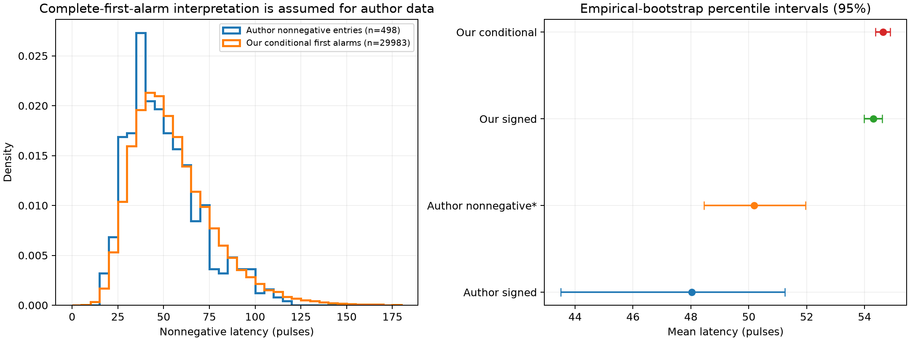

# Uncertainty in the released single-photon latency comparison

Source: [author dataset](https://zenodo.org/records/17460928), supplemental `lat` array and existing independently calibrated Python DV experiment. Original files and earlier studies are unchanged.

## Keep the delay statistics distinct

| Statistic | Runs | Mean (pulses) | Standard error | Bootstrap percentile 95% interval |
| --- | --- | --- | --- | --- |
| Author signed, as plotted | 500 | 48.034 | 2.029 | [43.510, 51.244] |
| Author nonnegative, conditional interpretation assumed | 498 | 50.181 | 0.894 | [48.452, 51.958] |
| Our signed first-alarm latency | 30000 | 54.304 | 0.158 | [53.986, 54.608] |
| Our conditional first-alarm delay | 29983 | 54.640 | 0.129 | [54.381, 54.892] |

The author array contains -844 and -129 pulses, with no zero entries. Those values are retained in the signed summary. Under the interpretation lat=T-cp they correspond to alarms on pulses 156 and 871, before change pulse 1000. The 498 nonnegative entries are separately re-summarized. The authors did not supply event flags, so that re-summary is not proof of their original event handling.



## Does the remaining gap disappear?

- signed: our mean minus author mean = 6.270 pulses (13.05%); bootstrap percentile interval [3.045, 10.783].
- conditional assuming author entries are complete first alarms: our mean minus author mean = 4.459 pulses (8.89%); bootstrap percentile interval [2.665, 6.206].

Using the nonnegative source re-summary instead of its signed mean moves the comparison by 2.147 pulses. It narrows the descriptive conditional-versus-published gap, but the comparable nonnegative mean is still lower than ours. The bootstrap interval for the conditional difference excludes zero under the stated assumptions; this is evidence of a remaining gap, not identification of its cause.

## Early alarms

| Data interpretation | Fraction | Wilson 95% interval |
| --- | --- | --- |
| author assuming first alarm latencies | 2/500 (0.400%) | [0.110%, 1.447%] |
| ours first alarm flags | 17/30000 (0.057%) | [0.035%, 0.091%] |

The author sample has only two negative entries. Neither their fraction nor the ratio of the two fractions estimates the unknown ARL, and no exponential stopping-time distribution is assumed. Our event flags and no-censoring status are directly checked against the saved 30,000-run experiment.

## Limits and reproduction

Author event flags, censoring handling and thresholds are unavailable. Conditional source re-summary assumes complete first-alarm T-cp entries. Empirical bootstrap assumes independent runs and does not capture ARL calibration error, missing events, model uncertainty or unseen tail events. No p-value or causal diagnosis is asserted.

Four independent random streams, each with 20,000 ordinary empirical bootstrap replicates, are used. Repeated integer values are grouped with multinomial counts, exactly equivalent to resampling the observations. Difference intervals combine independent author and Python resamples. They are percentile-bootstrap approximations, not calibrated finite-sample confidence bounds. Rare tail events missing from the 500 author runs remain unknowable from this sample.

```sh
python scripts/compare_dv_uncertainty.py --output results_dv_uncertainty_repeat
```

Use a fresh directory. This reads existing cached observations, validates original checksums, and saves mean resamples and plots. It generates no new detector trajectories and fits no detector threshold, channel parameter or published latency.
