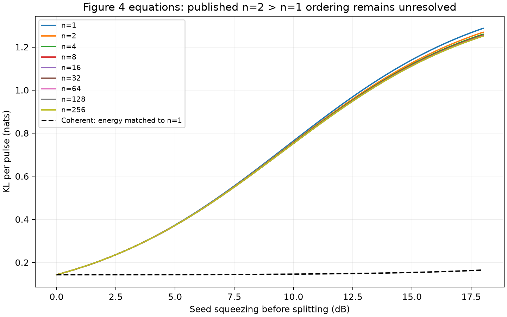

# Comparison at PDF-verified settings

Source: [arXiv:2503.12276v2 PDF](https://arxiv.org/pdf/2503.12276v2),
Figures 4/5 on PDF pages 3/4 and Figure 12 on PDF page 13 (one-based).
Downloaded source SHA-256:
`1cfd4db552f854c5d3138df9a0798d0f8b017bf13aa22e0a2a635b26ffc8a5da`.
The original figure rasters were extracted and inspected; author numerical data
for these figures are not included in the available Zenodo dataset.

## What this study establishes

Figure 5 uses N=100, Na=1, eta2=0.9 eta1, n=8 for ideal entanglement,
fractional LO amplitude error 0.01 and **phase variance 0.01, hence phase
standard deviation 0.1**. Its initial-loss axis spans 0–6 dB.
The classical probe uses 101 photons; the squeezed probe has displacement energy
100 and squeezing energy 1. Thermal occupation is zero. Appendix A explicitly
states that the plotted Kennedy entropy is evaluated from the PNR law in Eq.10.
The earlier phase SD=0.01/0.03 sweeps are retained as exploratory evaluations.

Figure 12 uses N=0, Na=1, eta2=0.9 eta1, n=8 and residual photons
0.0001/0.00001. Its initial-loss axis spans 0–5 dB. We evaluate a finite grid
from 0.05 to 5 dB and explicitly record infinite photon-counting KL at zero
initial loss. Both PNR and binary Kennedy observations are saved separately.
The original sample grids are unavailable; these are newly chosen smooth grids.


## Sparse comparison with published pixels

At 1 dB, seven approximate Figure 12 curve readings differ from the calculated
values by at most **1.67%**. Pixel uncertainty is ±5 pixels, about ±3% in
entropy. The squeezed-vacuum red-curve center was additionally confirmed with
an RGB scan of the original embedded raster. This supports agreement at one
loss value; it does not establish full numerical reproduction of all curves.
See [all seven readings](figure12_anchors.csv).

For Figure 5, four approximate black Kennedy marker readings show a much larger
difference. The coordinate mapping uses the original 971×734 raster, y=118 at
10 nats and y=625 at 0.001 nats. Marker uncertainty is ±3 pixels, approximately
±5.6%; it is a digitization bound, not a statistical error bar.

| Initial loss (dB) | Published Kennedy, approximate | Eq.10 PNR calculation | Ratio |
| --- | --- | --- | --- |
| 0 | 0.00486 | 0.05900 | 12.15 |
| 2 | 0.00292 | 0.03645 | 12.48 |
| 4 | 0.00176 | 0.02209 | 12.58 |
| 6 | 0.00112 | 0.01330 | 11.93 |

Changing the observation to binary click/no-click reduces the calculated
entropy slightly and does not resolve the gap. Increasing phase quadrature
from 96 to 160 points changes all seven calculated Figure 5 curve values at
0/2/4/6 dB by less than 1.0×10⁻¹⁴ relative. Individual count probabilities
also agree with an independent adaptive phase integral. No multiplicative
correction or fitted noise parameter is applied.

## Figure 4: an ordering discrepancy



At fixed seed squeezing s, Na=sinh²(s)/n and the collective variances do not
depend on n. Consequently the implemented block Gaussian equations imply

`KL_per_pulse(n) = B(s) + A(s)/n`,

where `A=(q-1-log(q))/2 >= 0`, `q=v2/v1`, and
`B=N*(sqrt(eta2)-sqrt(eta1))²/(2*v1)`.
This yields n=1 ≥ n=2 ≥ n=4, with equality at zero squeezing. Independent dense
covariance KL checks agree; the identity error across all 657 saved points is
6.7×10⁻¹⁶. At 18 dB the calculated values for n=1/2/4/8 are
1.28675/1.26862/1.25956/1.25502 nats per pulse.
The published inset places n=2 above n=1. The equation-versus-plot discrepancy
remains unresolved; it is not evidence identifying a particular author coding
error. The earlier study omitted n=1 from this comparison, so its n=2 ranking
only applied among the included entangled block sizes.

## Validation and reproduction

The full suite passes **368 tests**. The saved-data audit passes **958 checks**
when the downloaded original PDF is supplied: recalculated tables, source PDF
hash, 96/160-point refinement, physical inequalities, CSV/report consistency
and plot existence. Without the optional PDF the audit makes 957 checks.
An audit pass validates this calculation, not agreement with the published plot.
Earlier simulations and their raw arrays are unchanged; this deterministic
study introduces no fitted threshold or new delay Monte Carlo experiment.

From the existing environment:

```sh
python -m lossqcd.verified_figures --output results_verified_figures_repeat
python -m lossqcd.audit_verified_figures results_verified_figures_repeat
python -m pytest -q
```

The output directory must be new. To record/check the public PDF checksum,
pass `--pdf /absolute/path/to/2503.12276v2.pdf` to both figure and audit commands.
No network access is needed for equation regeneration. Manual digitization
coordinates are recorded explicitly in the source module and tables; they
should be revisited if higher-quality numerical source data become available.

Remaining reproduction work: clarify the Figure 4 and Figure 5 discrepancies,
and obtain the original simulation thresholds/event conventions to reconcile
the previously recorded Figure 3/7/11 latency differences. Figure settings
and a few pixel readings cannot resolve those missing simulation details.
